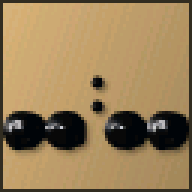

# HUB-75E · Clockwise Theme Clock

[简体中文](README.md) · English

A 64 × 64 native theme clock for ESP32 / ESP32-S3 and HUB75 panels. C/C++ themes compile to chip-specific Xtensa machine code in CWP3 packages. Current firmware does not run Lua.

Ferrofluid CPU preview: rest, shake, magnetic reassembly and changing digits, rendered by the same C++ code.



## Current release: 1.4.1

Fixes portal navigation, adds white-on-black setup QR codes capped at 24/255 brightness, and restores configured brightness afterward. Device requests are serialized; transient reads retry, writes are not replayed, and Wi-Fi/driver changes wait for reconnection.

Persistent per-app parameters are available in the device app list and USB workshop. Water exposes fill, gravity, droplets, viscosity and speed; S3 ferrofluid exposes magnet, gravity, oil drag, shake response, cohesion and morph time. The new Ambient Color Clock smoothly flows through a color palette.

Image clocks offer RGB565-matched LED/pixel previews, 19 fonts, Unifont Unicode text, eight decorative shapes, live dates, a seconds bar and optional image-free gradient backgrounds. Only rasterized assets and digit masks are installed; the complete Unicode fonts stay in the editor.


Fixes unintended full erase in legacy USB updates and the first-use LittleFS null-label reboot. Adds Wi-Fi → display → preferences onboarding, BOOT controls (single: QR/pause; double: next driver), S3 trial order 9 then 7, grouped chip variants, smooth brightness, and optional device-side updates every 6 hours. Automatic updates default off and retain settings and applications.

For `invalid header: 0xffffffff` or the format reboot loop, use **1.4.1 / Update firmware** over USB. Its separate boot and application images repair startup without erasing NVS or app storage. Previously erased data cannot be recovered. Both targets compile; no physical flashing was performed for this release.


- [Release downloads](https://github.com/AntonVanke/HUB-75E/releases/tag/v1.4.1): ESP32 4 MB and ESP32-S3 8 MB Flash + 8 MB OPI PSRAM.
- Six native applications: Super Mario (32 levels), Pac-Man, Gravity Water, Ball Maze, Ferrofluid Clock (S3 only), and Ambient Color Clock. Gravity applications require a detected IMU.
- Ferrofluid Clock v1.3.0 (S3 only): reference-video analysis, warm backing, side highlights and shadows, large drops slowly forming numerals, gravity dispersal and magnetic return.
- Installer Next transfers the released port into USB configuration, reads device status and offers Wi-Fi scanning and panel settings.
- Install CWP apps and image clocks directly from the workshop over USB. Generate a complete Codex prompt with project, SDK, ABI and build links interactively.
- Initialize only completely erased application storage; preserve damaged existing data. Probe IMU addresses 0x6A/0x6B with retries and report actual sensor absence.
- Image editor: up to 32 slides, mouse/touch positioning, text layers, 19 clock fonts, seconds, 12/24-hour time, shadows, crossfades and editable project export/import.
- Version selection, USB installation/update and matching applications on Pages. Device maintenance downloads and verifies firmware through the browser before OTA.
- Hardware tests for IMU, buzzer, temperature/humidity, display, light ADC and buttons. Unsupported hardware is reported explicitly.
- Compiled and computer-tested; this version has not been flashed or physically validated. Small changes increment PATCH (1.0.2), larger features increment MINOR (1.1.0).

[Native SDK and Codex prompt](theme-studio/native/README.md) · [Image clock studio](https://antonvanke.github.io/HUB-75E/studio/index.html)

The 0.9.x information below is retained as historical documentation. Legacy Lua/CWP2 applications do not run on the 1.4.1 native runtime.

**[Web installer, theme downloads and USB configuration](https://antonvanke.github.io/HUB-75E/)** · **[Firmware releases](https://github.com/AntonVanke/HUB-75E/releases)** · **[Flashing guide](FLASHING.en.md)**

**[OSHWHUB hardware project](https://oshwhub.com/team_rzwlbjjl/project_tfevmhyp)**: ESP32-S3 board, HUB75 level shifting, AHT30 temperature/humidity, LSM6DS3TR-C IMU, TF card and buttons. Submitted under MIT; platform review is pending. OSHWHUB hosts the circuit and PCB; GitHub hosts firmware, applications, the web installer and theme studio. Both project descriptions link to each other.

## Releases

| Release | Hardware | Notes |
| --- | --- | --- |
| [ESP32 v0.9.3](https://github.com/AntonVanke/HUB-75E/releases/tag/esp32-v0.9.3) | Classic ESP32, 4 MB Flash, no PSRAM required | Original DMA backend, CWP2 applications and device resource checks |
| [ESP32-S3 v0.9.7](https://github.com/AntonVanke/HUB-75E/releases/tag/esp32s3-v0.9.7) | The project's board with an 8 MB Flash layout and OPI PSRAM | DMA and Protomatter backends; profile 9 was tested on the P2.5-2121-32S-V1 panel |
| [ESP32 / S3 v0.9.8 feature build](https://github.com/AntonVanke/HUB-75E/releases/tag/v0.9.8) | Separate classic 4 MB and S3 8 MB + OPI PSRAM packages | API 2, sensors, orientation, USB installation and discovery; compiled from current source, not physically validated in this update |

The v0.9.3/v0.9.7 releases preserve the original prebuilt application binaries. The current source is v0.9.8; a new classic ESP32 build is not the historical v0.9.3 binary. The S3 package does **not** support S3 N4 modules with only 4 MB Flash. Other boards require matching Flash, PSRAM and pin configuration.

## Features

- 57 public applications with install, export, update and uninstall support; editable folder / ZIP projects and CWP2 device packages. Internal lunch menus and their data are excluded from the public repository.
- Eight new board themes: weather station, comfort garden, climate trend, gravity hourglass, level, maze, stardust and liquid. They require runtime API 2 and the corresponding detected sensors.
- Manual display rotation at 0/90/180/270 degrees; optional S3 gravity orientation with hysteresis, settling delay and manual fallback when the sensor is unavailable.
- One-click installation/removal and LAN discovery through the device interface or USB portal. Discovery requires compatible firmware on the same subnet; isolated clients and other VLANs are outside broadcast discovery.
- Chinese / English website, Lua editor, 64 × 64 preview and theme development guide.
- Interval rotation, daily schedules, time windows and selected rotation pools.
- Device settings for display, Wi-Fi, applications, schedules and OTA; line-delimited serial JSON configuration.
- Compatibility checks for chip, PSRAM, Lua and graphics memory. Declared requirements are not a performance certification.
- S3 v0.9.7 includes DMA profiles 0–6, GPIO diagnostics 7, Clockwise baseline 8 and Protomatter 9. Classic v0.9.3 does not include that new driver menu.

## Getting started

1. Open the [website](https://antonvanke.github.io/HUB-75E/) in desktop Chrome / Edge, select the matching chip and firmware, and connect the board over USB.
2. After installation, open **Device configuration** to set up Wi-Fi through the serial port, or send one JSON line at 115200 baud:

   ```json
   {"cmd":"wifi","ssid":"Your 2.4 GHz network","password":"Your Wi-Fi password"}
   ```

3. Send `{"cmd":"status"}` to read the IP address, then open the device's own web interface.
4. With v0.9.8, install directly in the device's application page or connect USB for one-click installation/removal on the website. Manual `.cwp` import remains available. Import an editable `.zip` into the studio to modify it.

The HTTPS website uses USB serial for configuration. It opens the local HTTP device interface separately and does not proxy your device through a cloud service. USB installation with `merged.bin` resets NVS / Wi-Fi settings; compatible same-chip OTA uses `app.bin` to preserve configuration. See the [flashing guide](FLASHING.en.md).

## Development

```sh
cd theme-studio
npm ci
npm run dev
```

Open `http://127.0.0.1:4317/`. The studio and [development guide](https://antonvanke.github.io/HUB-75E/studio/theme-guide.html) offer a language selector. A minimal project is available in [examples/hello-clock](theme-studio/examples/hello-clock/README.md).

```sh
cd theme-studio
npm run build
pio run -d embedded/demo -e esp32s3-hub75
```

The classic target is `esp32-64x64`. Repackage the preserved binaries with `python tools/package-releases.py`; generate the Pages site with `python tools/build-site.py`. Pages serves `main:/docs`.

Source directories: `theme-studio/studio/` (browser UI), `theme-studio/embedded/` (firmware), `theme-studio/themes/` (public themes), `web/` (portal), `docs/` (static output), `releases/` (firmware packages), `enet/` (hardware netlists), and `routing/` (PCB exports). The 2026-11-01 netlist and 2026-10-27 PCB exports are different design revisions; check the actual design before fabrication.

## Acknowledgements and licensing

Special thanks to **[ClockWise Plus](https://topyuan.top/clock/)** and its author **[MonsterYuan / 冯雪原 (yuan910715)](https://github.com/yuan910715)** for the clock-face designs, pixel-art references and project documentation.

This project also builds on [jnthas/clockwise](https://github.com/jnthas/clockwise), mrcodetastic HUB75 DMA, Adafruit Protomatter / GFX / BusIO, Lua and browser libraries. Thank you to their authors.

The existing [LICENSE](LICENSE) is preserved. Third-party code, fonts, artwork, game / film characters and trademarks retain their original rights; the repository's MIT license does not relicense them. See [THIRD_PARTY_NOTICES.md](THIRD_PARTY_NOTICES.md).
